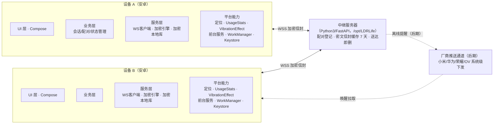
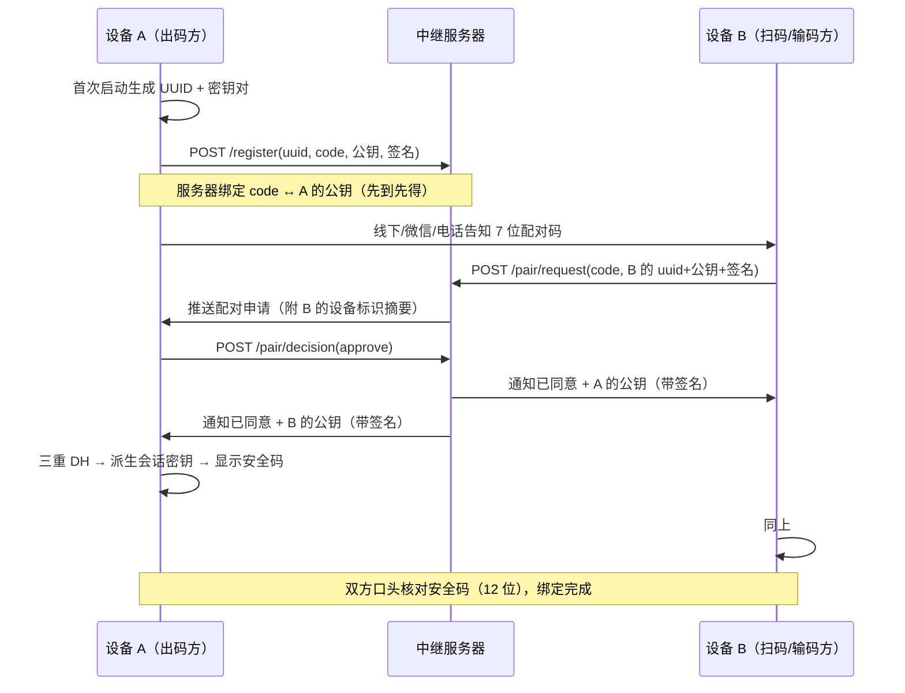

# LDRLife 异地恋生活 App —— 调研与设计方案（Android · 决策版）

> 版本：v0.8 ｜ 日期：2026-11-25 ｜ **M0 已完成并通过跨端联调**：Python 服务器测试 7/7；Android APK 真机（MuMu 15）安装运行；配对→审批→密钥交换→加密消息 全链路跑通（Kotlin 与 Python 两套独立实现加密互操作验证 ✓）
> 关键决策已确认（见 §14）：**开源 AGPL-3.0（github.com/Mengpolar/LDRLife，Public）、应用名「倾卿」、Kotlin + Compose 原生开发、双安卓、自有服务器部署于 /opt/LDRLife（共存红线）、接口门禁防扫描、TLS 走子域名 relay.p01arbear.top + Let's Encrypt**。
> 服务器 IP/凭据**不写入任何入库文件**，仅部署会话使用。关键待拍板项已全部清零。

---

## 1. 产品概述

**一句话定位**：给异地情侣的专属小 App —— 一对一绑定、互相看见彼此的位置与"此刻状态"、端到端加密私聊、一键把"想你了"震进对方手心。

> 应用名：**倾卿**（桌面显示名）｜ 项目/仓库名：LDRLife ｜ 包名：`com.mengpolar.ldrlife`

**三条设计原则**：

1. **隐私优先**：明文只存在于两台手机内；服务器只接触密文与路由信息；一切共享内容可随时关闭；不留历史。
2. **双方知情同意**：位置、应用状态均为"共享"而非"监控"，任何一方可随时暂停，对方端界面明确标注数据来源与时效。
3. **距离即情感**：产品的核心交互（地图上的两个人、公里数、振动）都围绕"物理距离"这一异地恋的本质情绪。

---

## 2. 需求与可行性总评

| # | 需求 | 结论 |
|---|------|------|
| F0 | 配对：设备唯一 ID → 配对码 → 申请 → 审批绑定 | **可行**。防猜码：限流 + 属主审批 + 安全码比对，见 §4 |
| F1 | 地图展示双方大致位置 + 距离 + 自适应缩放 | **完整可行**，见 §6 |
| F2 | 对方正在使用 / 最近使用的 App | **全自动可行**（UsageStatsManager，需特殊授权），见 §7 |
| F3 | 一对一 E2E 消息、本地存储、服务器仅缓存密文（7 天 TTL） | **可行**，见 §5 |
| F4 | "想你了"：发送指定节奏/频率的振动 | **完整可行**：前台直调 + 后台经通知渠道振动图案，见 §8 |

**关键调研结论（均已核实，查证日 2026-11-24）**：

- **应用使用数据可用**：UsageStatsManager 提供 `queryEvents`（事件流，系统仅保留数天）、`queryUsageStats`（聚合统计）；`PACKAGE_USAGE_STATS` 为特殊权限，不能动态弹窗，须引导用户到系统设置"使用情况访问权限"页手动开启。
- **"耗电排行"无公开 API**（BatteryStats / BatteryUsageStats 均非公开 SDK，Android 9 起非 SDK 接口封锁）→ 用**前台使用时长 / 最近使用时间**替代，语义上更贴合"对方现在在干嘛"。
- **振动能力完整**：`VibrationEffect.createWaveform`（API 26+）支持时序 + 幅度 1-255 自定义节奏；通知渠道 `setVibrationPattern` 支持后台自定义图案；Doze/待机桶限制清单**不含振动**；Android 13+ 必须授予 `POST_NOTIFICATIONS` 运行时权限，否则整组通知（含振动）被封禁。
- **国内 Android 没有 FCM**，消息送达靠 WS 长连接 + 前台服务保活（引导电池白名单/自启动），后期接厂商推送聚合。
- **Kotlin 技术栈配套成熟**：本地加密库用 Room + SQLCipher（net.zetetic `sqlcipher-android`，官方社区维护）；加密原语用 **BouncyCastle 纯 Java 实现**（X25519 / Ed25519 / ChaCha20-Poly1305，免 JNI、接口确定性强）；高德 **Android 原生 SDK** 官方持续维护（此前排查到的仅是 Flutter 插件停更问题，Kotlin 原生路线无此风险）。
- **libsignal 有 Java/Android 绑定**（`org.signal:libsignal-android`，AGPL-3.0）——**本项目开源后许可证兼容**，终态升级路径畅通，见 §5.2。

---

## 3. 总体架构



**信任边界**：明文仅存在于两台设备内部；服务器只见信封元数据（路由 ID、时间、密文长度）；厂商通道只携带"有新信封"信号（不承载密文），App 收到信号后拉取解密。

客户端四层：UI 层（Compose）→ 业务层（会话/配对/共享状态）→ 服务层（WS 客户端、加密引擎、加密本地库）→ 平台能力（定位、UsageStats、振动、前台服务、Keystore、WorkManager）。

---

## 4. 设备配对设计（F0）

### 4.1 设备身份与配对码

**设备身份**（App 首次启动生成，不依赖系统 ID）：

- `deviceUUID` = UUIDv4，随机生成。
  - 为什么不用系统 ID：`ANDROID_ID` 恢复出厂会变、不同签名下可能不同，不可控。自生成 UUID 是可控方案。
  - 存储：Android Keystore 生成 AES-GCM 密钥加密后存私密目录；**重装 App = 新设备**，需重新配对（可接受，配对成本很低）。
- 密钥对 1：**X25519 身份密钥对**（E2E 加密用）。
- 密钥对 2：**Ed25519 签名密钥对**（注册、配对申请防冒名用）。
- 密钥保管：Android 13+ 的 Keystore2 支持 Curve25519（X25519/Ed25519），可直接入库；更低版本由 BouncyCastle 软件生成，私钥用 Keystore AES-GCM 包裹加密后存储，均不可导出。有 StrongBox 的设备优先用硬件安全模块。

**配对码**（由设备唯一 ID 确定性生成，符合需求原意）：

```
code = SHA-256( deviceUUID || "LDRLIFE-PAIR-V1" ) mod 1_000_000   → 6 位十进制（前导零保留）
再加 1 位 Luhn 校验位                                              → 共 7 位，如 438 2017
```

- 确定性：换设备才换码，方便口头/微信传抄。
- 校验位：抄错一位当场发现，省去"发了申请对方没反应"的排障。
- 显示格式 `438 2017`，配"复制 / 二维码"按钮（线下见面可扫码直连，二维码内容 = code + 公钥 + 签名）。

### 4.2 绑定流程



- **申请防骚扰**：B 拿到的只是"给 A 发申请"的资格，A 不点头绑定永不生效；服务器按 code 限流（如 20 次/天）。
- **解绑**：任一方可解绑 → 服务器清除绑定与缓存信封 → 双方收到解绑通知 → 可选"抹掉本地聊天记录"。换手机/重装 = 新设备重新配对。

### 4.3 密钥交换与安全码

- 会话密钥：双方在配对确认时互换**临时 X25519 公钥**（带 Ed25519 签名），做三重 DH：
  `shared = X25519(ephA, ephB) ‖ X25519(idA, ephB) ‖ X25519(ephA, idB)`
  再经 HKDF-SHA256 派生两个方向的独立对称密钥；HKDF info 绑定双方公钥，防未知密钥共享（UKS）攻击。
- **安全码**：`SHA-256(sort(pubA, pubB))` 取 12 位 hex 分 3 组显示（如 `3F2A 90BE C41D`），双方在电话里念一遍一致，即排除中间人。UI 常驻于设置页。
- 配对确认后，服务器上的登记仅保留：uuid ↔ 公钥 ↔ 绑定关系；配对申请记录即删。

---

## 5. 端到端加密通讯（F3）

### 5.1 消息状态与服务器缓存（已拍板）

**威胁模型**：防网络窃听、防服务器读内容、防服务器拖库泄露聊天内容；不防手机本身被解锁/Root 后提取（个人使用范围，文档声明）。

**已确认口径**（模式 A 变体）：

- A 给 B 发消息，B 离线时消息**以密文缓存在服务器，最多 7 天**，过期自动清理。
- B 上线后从服务器接收消息并回 ACK；A 端状态随之更新。
- **7 天内始终未送达（B 一直未上线）→ 服务器清理 → A 端对应消息显示红色感叹号**，可一键重发。
- 服务器全程只有密文 + 路由字段（无密钥，不可读）；取走即删。

**消息状态机（A 端显示）**：

```
发送中 → 已送达（服务器确认收到/缓存）→ 已送达 ✓✓（B 从服务器取走，ACK 回传）→ 已读（B 打开会话）
        ↘ 7 天 TTL 过期未送达 → ❗ 红色感叹号（可重发）
```

> 说明：按上述状态机，"已送达 ✓✓"与"已读"是两个状态（B 取到消息 ≠ B 看了消息），都比需求口径更精确，体验上不冲突。

### 5.2 密钥体系（三步走）

| 阶段 | 方案 | 前向保密 | 说明 |
|------|------|----------|------|
| MVP | 静态 ECDH 派生双向密钥 + ChaCha20-Poly1305 AEAD，每方向 nonce = 会话随机前缀 4B + 计数器 8B（升级哈希棘轮时换 XChaCha 随机 nonce） | ❌ | 结构极简、易验证；配对即重建密钥。**已按此实现**（BouncyCastle 纯 Java） |
| v1.1 | 哈希棘轮：`chain = HMAC(chain, 0x01)`，`msgkey = HMAC(chain, 0x02)` 用后即弃；每 24h 或每 500 条做一次新 DH 换根 | ✅（泄密只伤及当前链） | 原语全部用 BouncyCastle/Tink，不手搓密码学 |
| 终态（可选） | 接入 libsignal（Double Ratchet，Java 绑定 `org.signal:libsignal-android`） | ✅ 完整 | AGPL-3.0——**本项目开源后许可证兼容**，此路径已无障碍；集成需 Rust 工具链，放到有精力时再做 |

> 原则：**不自己实现密码学原语**（只用经审计的 BouncyCastle/Tink），自研部分仅限"协议组装"。项目开源后协议与实现可被公开审阅。

### 5.3 信封格式与消息类型

```json
{
  "v": 1,
  "type": "msg | ack | read | loc | usage | haptic | pair",
  "sid": "发送端密钥ID(公钥指纹前8位)",
  "rid": "接收端密钥ID",
  "seq": 128,
  "ts": 1730000000,
  "ct": "base64(XChaCha20-Poly1305 密文)"
}
```

服务器只见路由字段；`loc / usage / haptic` 的业务载荷全部放在密文内，与消息走同一条 E2E 通道（服务器也看不到你们在哪、在用什么 App）。

**配对信封（type_hint="pair"）是唯一例外**：载荷为双方公钥/临时公钥与签名——本就是公开信息，以明文 JSON 传输。流程：审批通过 → 服务器向申请方投递 `pair_approved`（仅含审批方公钥）→ 申请方回发 `pair_eph`（临时公钥 + Ed25519 签名）→ 双方收齐后做三重 DH 派生会话密钥。`msg` 信封的 AAD 绑定 `LDRLIFE1|msg|发送方uuid|接收方uuid|seq`，nonce 编码同一计数器，防跨会话重放与篡改。

### 5.4 可靠性：ACK / 离线队列 / TTL

- 服务器缓存队列：WS 在线直推；不在线落库（**TTL 7 天**），取走 + ACK 即物理删除；定时清扫过期。
- 客户端重发：WS 断线自动重连 + 指数退避；`seq` 去重幂等；本地"发送中"队列持久化，崩溃恢复后补发。
- TTL 过期：客户端从 `expires_at` 推算，本地直接把对应消息置为 ❗（服务器清理动作与客户端标记动作并行，双保险）。
- 无云端备份（隐私原则）：换手机聊天记录不迁移，仅本机保留；设置页提供"导出加密备份文件"（可选，M4）。

### 5.5 本地存储

- **Room + SQLCipher**（net.zetetic `sqlcipher-android`，Android 原生成熟组合，社区官方维护）。
- 库密钥：随机 32B 生成一次，存 Android Keystore（有 StrongBox 优先硬件级）。
- 消息表：`(id, direction, seq, body, type, ts, status[发送中/已送达/已读/❗过期])`；partner 表、共享状态表（位置/应用状态各只存最新一条，**不留历史**）。

### 5.6 消息送达与通知（Android）

- **基础方案（MVP）**：WS 长连接 + **前台服务**常驻（一条低调的常驻通知），信封到达即解密展示。
  - Android 13+ 必须授予 `POST_NOTIFICATIONS` 运行时权限（首次启动引导）。
  - 首次启动引导"电池白名单 / 自启动"设置教程页：小米等厂商的自启动须经用户在系统设置中允许（小米官方《自启动权限管理说明》确认此模型），华为/荣耀/OV 类似。
- **进阶（M4 后）**：接入厂商推送聚合（极光 JPush / 个推，已覆盖小米/华为/鸿蒙/荣耀/OPPO/vivo/魅族等系统级通道），通道只传"有新信封"信号——厂商透传消息有配额与格式限制，不能承载密文——App 收到信号后拉取信封解密。

### 5.7 媒体消息（M4 可选）

图片/语音/视频：本地 AES-GCM 加密 → 上传加密 Blob 至对象存储（TTL 7 天自动删）→ 下载 URL + 解密密钥放进 E2E 信封 → 对方下载后解密并只存本地。服务器始终无密钥。MVP 先做纯文本，不阻塞主链路。

---

## 6. 地图位置共享（F1）

### 6.1 地图 SDK

- **高德 Android 原生 SDK**（官方持续维护，Kotlin 原生路线直接依赖，无插件停更问题），全链路 **GCJ-02 坐标**，测距无需坐标系转换。
- 保留一层薄 `MapEngine` 接口（显示 / fitBounds / marker / 缩放）：当前无成本，未来若做 iOS 可复用业务代码。

### 6.2 精度分级（"大致位置"的产品化）

| 档位 | 处理方式 | 实际精度 | 默认 |
|------|----------|----------|------|
| 精确 | 原始定位 | ~100m | |
| **模糊** | 坐标截断到小数点后 2 位（≈1.1km 网格对齐） | ±1.1km | ✅ |
| 城市 | 仅上报城市名 + 城市中心点 | 城市级 | |

- 用"网格对齐"降精度而非随机偏移：数据不撒谎，只是分辨率降低，距离估算仍可信。
- 地图上对方 marker 用半透明大圆呈现模糊圈；本地 UI 明示当前精度档，一键切换。

### 6.3 更新策略

- 默认：**打开 App 时定位 + 下拉刷新**。不申请后台定位权限（合规负担最小、耗电为零）。
- 可选开关：每 15 分钟周期上报（WorkManager）。
- 不做实时移动轨迹（异地恋场景不需要，且是隐私负担）。

### 6.4 展示与自适应缩放

- 两个 marker + 连线（虚线），主视角自动包含两人。
- 自适应缩放：用高德 `CameraUpdateFactory.newLatLngBounds(bounds, padding=80)`；自实现时按 Mercator 计算：
  `zoom = min( zoomFor(经度跨度), zoomFor(纬度跨度) )`，缩放上限 16（避免同城时糊脸），下限 3。
  经验映射表（备用）：`<1km→z15 ｜ <5km→z13 ｜ <20km→z12 ｜ <100km→z10 ｜ <500km→z8 ｜ <2000km→z6 ｜ 其余→z4`。
- 距离标签：Haversine 直线距离，`d = 2R·asin(√(sin²(Δφ/2) + cosφ1·cosφ2·sin²(Δλ/2)))`，R=6371km；显示"直线距离约 1085 km"（按精度档加"约"）。
- 情感彩蛋（backlog）：距离缩到 500km 以下 / 重逢 <1km 时给专属动画。

### 6.5 新鲜度与离线表现

- 每个位置点带时间戳，UI 显示"x 分钟前更新"；超过 24h 显示"位置已过期"。
- 离线时显示最后已知位置，不装作实时。

---

## 7. 应用使用状态（F2）—— 全自动

### 7.1 能力与权限

- `UsageStatsManager`：`queryEvents()` 取前台事件流（系统仅保留数天）；`queryUsageStats(DAILY)` 取按日聚合的使用统计。
- 权限：`PACKAGE_USAGE_STATS` 为特殊权限（appop 类），Manifest 声明后**不能动态弹窗**，须引导跳转 `Settings.ACTION_USAGE_ACCESS_SETTINGS` 让用户手动开启——做成一次性引导页 + 设置页常驻入口。
- 备选 API：`queryAppUsageDuration()`（仅需 `QUERY_APP_USAGE` 权限）但只能回看 30 天。

### 7.2 "正在使用"与"最近使用"判定

- **正在使用**：查最近 2 分钟 `UsageEvents`，取最后一个 `ACTIVITY_RESUMED` 且未收到对应 `PAUSED` 的包。
- **最近使用**：`queryUsageStats(DAILY)` 按 `lastTimeUsed` 倒序取 Top 3；**"耗电排行"已无公开 API**，用前台使用时长替代，产品文案写"最近在用"而非"耗电排行"。
- 应用名经 PackageManager 解析为展示名（"微信"而非 `com.tencent.mm`）；内置常见 App 分类表（社交/短视频/购物/游戏/工作），未收录归"其他"。
- 默认排除：系统 UI、输入法、桌面、本 App；支持自定义黑名单。

### 7.3 同意分级与隐私控制（这是"共享"不是"监控"）

| 级别 | 对方看到 | 默认 |
|------|----------|------|
| L0 | 关闭（对方看不到任何信息） | |
| L1 | 仅"使用手机中 / 未使用" | |
| L2 | 应用类别（社交/游戏/短视频/工作/其他） | |
| **L3** | 应用名 + 最后使用时间（"微信 · 3 分钟前"） | ✅ |
| L4 | 最近使用 Top3 列表 | |

- 一键"专注模式"：临时隐藏一切状态；可随时撤回授权。
- **只显示当前/最近一条，双方设备都不留历史**——不做"应用使用时间轴"，这是明确的隐私红线。
- 对方端 UI 永远标注数据时间（"3 分钟前"），绝不暗示实时监控。

### 7.4 上报与节流

- 状态变化即上报 + 最长 5 分钟心跳；UsageStats 查询在屏幕亮起时执行，耗电极低。
- 载荷作为 E2E 信封（type=usage）随消息通道发送，服务器不可见。

---

## 8. "想你了"振动（F4）

### 8.1 振动模式编码（E2E 信封内的载荷）

```json
{
  "name": "心跳",
  "repeat": 3,
  "events": [ { "at": 0, "dur": 120, "amp": 0.9, "freq": 0.6 },
              { "at": 280, "dur": 180, "amp": 0.7, "freq": 0.4 } ]
}
```
`at` 毫秒偏移、`dur` 持续、`amp` 0-1 强度、`freq` 0-1 频率感。

### 8.2 渲染能力（Android）

| 场景 | 能力 |
|------|------|
| **App 前台** | ✅ 直调 `Vibrator` 播放完整图案，无额外限制 |
| **后台/锁屏** | ✅ 经通知渠道振动图案送达：`NotificationChannel.setVibrationPattern`（**渠道创建时一次性设定**——每种预设图案建一个固定渠道，自定义图案动态建渠道并管理数量）；Doze/待机桶限制清单均不含振动 |
| 节奏 | `VibrationEffect.createWaveform`（API 26+）：时序 + 幅度 1-255 序列，可循环；API 29 起另有预定义效果与组合原语 |
| 频率感 | 短脉冲占空比近似（如 30ms 开/30ms 关 ≈ 高频嗡嗡手感），幅度控制强弱 |

> 前提：Android 13+ 必须授予 `POST_NOTIFICATIONS` 运行时权限，否则整组通知（含其振动）被封禁。

### 8.3 预设模式

| 预设 | 图案（waveform 序列） |
|------|----------------------|
| 心跳 💓 | 咚(120ms, 强)-歇-咚(180ms, 中) × 800ms 周期 × 4 拍 |
| 高频嗡嗡 | 30ms 开/10ms 关 × 1.5s，幅度 255 |
| 轻挠 | 6 × 40ms 弱脉冲（幅度 64） |
| 长抱 | 2000ms 匀速强振 |
| 摩斯密码 | 输入文字 → 摩斯码节奏（仅字母/数字，彩蛋功能） |

发送前可"先感受再发送"（本地预览）；支持自建模式（M4）。

### 8.4 送达策略

- 对方 App 前台：全屏动画 + 完整图案播放 + 可"回一个"。
- 对方后台：通知 + 对应预设渠道的自定义振动图案。
- 对方离线：作为 E2E 信封排队（同消息队列，7 天 TTL），送达后对方打开时补播并提示"TA 在 xx 时间想你了"。

---

## 9. 后端服务设计

### 9.1 原则

单实例小服务，**无账号体系**（uuid + 公钥即身份），信封送达即删，日志不记录信封内容。TLS 强制（WSS/HTTPS）。

### 9.2 接口门禁与端点清单（防扫描，已拍板）

**门禁规则：所有接口必须携带部署级门禁密钥才正常响应，否则一律 404**（与不存在的路径返回完全相同的响应，爬虫探测无从区分真假路径）：

- 门禁密钥 `gate`：部署时生成（24 位以上随机串），写在 `config.toml`（不入库）；两台设备的 App 在"服务器设置"里与服务器地址一并手动填入。
- 载体：**URL 路径前缀 `/{gate}/v1/...`**（优于 query 参数：路由层统一处理，路径不对即 404）。
- 统一 404 表现：空 body、无多余响应头（隐藏 `Server` 等指纹）、根路径 `/` 亦 404、不设 `/health` 类可探测端点。
- **404 同样计入限流**：单 IP 404 频次超阈值（如 60 次/分钟）即临时封禁，防门禁密钥爆破。

| 端点（均带 `/{gate}` 前缀） | 作用 |
|------|------|
| `POST /{gate}/v1/register` | 登记 uuid、配对码、公钥（带 Ed25519 签名验证） |
| `POST /{gate}/v1/pair/request` / `pair/decision` | 配对申请与审批（完成后申请记录即删） |
| `WS /{gate}/v1/ws` | 双向加密信封通道 + 30s 心跳（在线状态） |
| `POST /{gate}/v1/envelope` | 离线兜底投递 |
| `GET /{gate}/v1/envelope/pending` + `POST /{gate}/v1/envelope/ack` | 拉取缓存信封并确认删除 |
| 限流 | 按 uuid / 按配对码（配对码查询 20 次/天）＋按 IP 的 404 限流 |

### 9.3 服务器数据（极简）

```
device(id, uuid, pairing_code, x25519_pub, ed25519_pub, last_seen)
pairing_request(from, to, created_at)        -- 处理完即删
envelope(id, from, to, type_hint, ct, seq, created_at, expires_at)  -- ACK 即删 + 7 天 TTL 清扫
```

### 9.4 部署（洁癖式：一切只在 /opt/LDRLife）

- 目标服务器：自有腾讯云主机。
- **目录布局**（全部收敛在一个目录，删除目录 = 系统恢复原状）：

```
/opt/LDRLife/
├── main.py 等        # 服务端 Python 源码
├── venv/             # Python 虚拟环境（pip 依赖，全部收敛在本目录）
├── requirements.txt  # 依赖清单
├── config.toml       # 配置（端口/门禁密钥/限流参数）
├── data/             # SQLite（device 表 + 信封缓存队列）
└── uninstall.sh      # 一键卸载：停服务 + 删 unit + 删本目录
```

- 唯一游离文件：`/etc/systemd/system/ldrlife.service`（开机自启/崩溃拉起），uninstall.sh 负责清除。
- **部署红线（服务器上另有其他对外服务，已拍板勿扰）**：
  - 端口：部署前先 `ss -tlnp` 盘点已占用端口，本服务只绑定一个**全新高位端口**，不与任何现有服务冲突；防火墙只做"新增放行"，不改动现有规则。
  - 不修改、不重启任何现有服务的配置与进程；新增内容仅限 `/opt/LDRLife` 目录 + 一个 systemd unit。
  - uninstall.sh 只清理上述新增项，绝不触碰其他服务。
- **凭据不入库**：服务器 IP/密码不写入任何仓库文件，部署时经本地环境变量注入。
- **部署后安全清单**：改 SSH 密钥登录并禁用 root 密码登录、防火墙只放行新服务端口与 SSH、服务器地址与门禁密钥在 App 设置中可配置（开源自托管友好）。
- **TLS（已拍板）**：子域名 `relay.p01arbear.top` A 记录指向服务器（由你配置）；证书用 **Let's Encrypt DNS-01 验证**签发——不需要占用 80/443 端口，完全符合"不动现有服务"红线；acme.sh 自动续期并重载 ldrlife 服务；App 端走标准证书校验（无需自签锁定）。
  - 服务端口仍用全新高位端口（部署时 `ss -tlnp` 盘点后确定）：`wss://relay.p01arbear.top:<高位端口>`。
  - 提示：若 p01arbear.top 未做 ICP 备案，境内云商通常会拦截 80/443 上的域名访问；本服务只用高位端口，不受该拦截影响（两人规模 + 门禁密钥保护，实际风险很低）。
- **部署时需要你操作的事项**：① 配置子域名 A 记录（`relay.p01arbear.top` → 服务器 IP）；② 提供 DNS 服务商的 API 凭据（供 acme.sh 做 DNS-01 自动续期，仅存服务器本地不入库）；③ M2 前在高德开放平台申请 Android Key（地图 SDK 需要）。
- 备份：仅备份 device 表（信封缓存本身可丢 = 隐私友好）。

---

## 10. 开源分发与合规（Android）

### 10.1 更新与分发（GitHub：Mengpolar/LDRLife）

- 仓库：**https://github.com/Mengpolar/LDRLife**（Public，已确认），monorepo 结构：`/app` 客户端、`/server` Python 中继、`/docs` 设计文档（去除敏感项后入库）。
- **许可证：AGPL-3.0**（已拍板，仓库根放 LICENSE 文件；与未来 libsignal 集成兼容）。
- **分发**：GitHub Releases 提供 APK（GitHub Actions 自动构建 + 输出 SHA-256 校验值）。
- **应用内更新**：检查更新 → `GET api.github.com/repos/Mengpolar/LDRLife/releases/latest` → 比对 `versionCode` → 下载 APK asset → SHA-256 校验 → 弹安装。
- **国内加速**：下载地址支持**镜像前缀**（如 `https://gh-proxy.org/<原始URL>`），内置可配置镜像列表，依次尝试直至成功；README 同步提供直链 + 镜像链接。

**git 提交前隐私核查（强制清单，每次 push 前过一遍）**：

| 检查项 | 内容 |
|--------|------|
| 代码/注释扫描 | 全局正则检索：IPv4 地址、password/token/secret 等字样、11 位手机号、真实姓名、个人邮箱、`C:\Users\...` 等本机路径 |
| 历史提交 | gitleaks / trufflehog 扫全量 history（泄露常发生在历史 commit 而非最新代码）；GitHub 自带 secret scanning 保持开启 |
| 文档核查 | 入库文档（含本设计文档）确认无服务器 IP/凭据/个人信息/真实位置示例 |
| 签名密钥 | `*.jks`、keystore、签名密码绝不入库：放本地目录 + 环境变量，CI 签名用 GitHub Secrets |
| 截图 | README 截图不得包含真实位置/聊天内容（地图页会暴露常驻地），一律用模拟数据截图 |

**.gitignore 关键约束**：

```
# 客户端（/app）
build/          .gradle/        local.properties
*.jks           *.keystore      keystore.properties
.idea/          captures/       *.hprof
# 服务端（/server）
config.toml     data/           logs/           *.db
# 部署与密钥（仓库根）
deploy/*.local.*                .env*           !.env.example
# 通用
.DS_Store       Thumbs.db       *.log
```

- 入库的是模板：`config.example.toml`（无真实值）；真实 `config.toml`、服务器 IP、门禁密钥、签名密钥全部只在本地持有。

### 10.2 权限清单

| 权限 | 类型 | 用途 | 申请时机 | 拒绝后果 |
|------|------|------|----------|----------|
| 精确/粗略定位 | 运行时 | 位置共享 | 首次进入地图页 | 无法共享位置 |
| PACKAGE_USAGE_STATS | 特殊授权（设置页） | 应用使用状态 | 首次开启该功能 | 该功能不可用 |
| POST_NOTIFICATIONS | 运行时（13+） | 消息/振动提醒 | 首次启动引导 | 收不到提醒，通知振动一并失效 |
| VIBRATE | 普通 | "想你了" | 默认 | 无法振动 |
| 电池优化白名单 / 自启动 | 系统设置引导（非权限） | 后台保活 | 引导页，可选 | 后台消息延迟 |

### 10.3 PIPL 要点（开源项目同样建议遵守）

- **位置属敏感个人信息**（PIPL 第 28 条"行踪轨迹"）：依第 29 条必须取得**单独同意**（不能混入打包勾选）+ 可撤回 + 最小必要 + 隐私政策页。
- **应用列表**未被 PIPL 列入敏感类别（按一般个人信息，告知-同意即可），但"超范围收集应用列表"历来是工信部通报整治重点：坚持最小化——只取展示所需的应用名/类别，不留历史，不批量上传。

### 10.4 未来若上国内商店（当前不做，材料备忘）

工信部 App 备案（信管〔2023〕105号）+ 软著 + 隐私政策弹窗 + 权限用途说明（小米平台 2025-09 文档已核实此要求）；"应用列表"权限是审查重点。

---

## 11. 技术选型汇总

| 层 | 选择 | 备选 | 理由 |
|----|------|------|------|
| 客户端 | **Kotlin + Jetpack Compose**（已拍板） | — | 全部功能直接调系统 API，无桥接层；前台服务/WorkManager/厂商 SDK 集成最顺；单语言、APK 小 |
| 地图 | 高德 Android 原生 SDK | — | 官方维护，GCJ-02 全链路；薄 MapEngine 接口留扩展 |
| 本地存储 | Room + SQLCipher（`sqlcipher-android`） | — | Android 原生成熟组合，社区官方维护 |
| 加密原语 | BouncyCastle 纯 Java（X25519 / Ed25519 / ChaCha20-Poly1305） | Google Tink（HPKE，Apache-2.0） | 免 JNI、接口确定性强、审计充分；libsignal（AGPL）留作终态升级 |
| 后端 | Python3 + FastAPI + WebSocket + SQLite | Go 单二进制 | 部署运维简单、生态熟悉（已按 Python 实现）；uvicorn 单进程足够两人规模 |
| 消息送达 | WS 前台服务 + 电池白名单引导（后期厂商推送聚合） | — | 国内无 FCM 的现实约束 |
| 分发/CI | GitHub Releases + Actions（Public 仓库）；国内镜像加速（gh-proxy.org 等）；AGPL-3.0 | — | 已拍板的开源路线 |
| 服务端运维 | systemd unit + /opt/LDRLife 单目录 + uninstall.sh | Docker | 洁癖式部署：删除目录 = 系统恢复原状 |

---

## 12. 里程碑规划

| 里程碑 | 周期 | 交付 | 验收标准 |
|--------|------|------|----------|
| M0 打通主链路 | 第 1-2 周 | Kotlin/Compose 骨架 + 配对全流程 + WS 在线文本消息 | ✅ **已完成（2026-11-25）**：MuMu 15 模拟器 + 本地服务器 + Python 测试端联调，配对→审批→加密消息全链路通过 |
| M1 消息完整化 | 第 3-4 周 | Room+SQLCipher 本地库、离线缓存（TTL 7 天）、送达/已读/❗过期、前台服务 + 通知 | 断网重连不丢消息；过期消息显示红色感叹号 |
| M2 位置共享 | 第 5 周 | 地图双 marker、距离、自适应缩放、精度分级 | 两地真实距离展示正确 |
| M3 差异化功能 | 第 6-7 周 | 想你了（振动全套）+ 应用使用状态（自动） | 前台实时体验完整；后台通知图案可靠 |
| M4 打磨与开源 | 第 8 周+ | GitHub 更新通道（镜像加速）、媒体消息、设置页、白名单引导教程、README/协议文档、Actions 构建流水线 | 全新设备可从 GitHub 下载安装并完成配对 |

> 依赖说明：消息通道（M0/M1）是 F1/F2/F4 的载体（位置/状态/振动都走 E2E 信封），故先行；M2/M3 顺序可按意愿对调。

---

## 13. 风险清单

| 风险 | 等级 | 缓解 |
|------|------|------|
| 国产 ROM 杀后台 → 消息延迟 | 高 | 前台服务 + 电池白名单/自启动引导教程；后期厂商推送聚合 |
| POST_NOTIFICATIONS 被用户拒绝 | 中 | 明确用途说明引导授予；拒后提示功能受限 |
| GitHub 国内直连不稳定（更新/下载） | 中 | gh-proxy.org 等镜像前缀依次尝试；release 附 SHA-256 保证完整性 |
| 接口被爬虫/扫描器批量探测 | 中 | 门禁密钥路径前缀，未携带一律 404；404 限流 + IP 临时封禁；无指纹响应头（§9.2） |
| 自研加密协议强度不及 Signal | 中 | 只用审计原语；项目开源可被审阅；libsignal 升级路径畅通（AGPL 兼容）；两人自用威胁模型下风险可控 |
| 服务器凭据/端口暴露 | 中 | 部署后立即改密钥登录、禁 root 密码、防火墙限端口；凭据永不入库 |
| 配对码被猜测滥用 | 低 | 限流 + 属主审批 + 安全码比对 |
| 服务器单点故障 | 低 | 无状态队列 + device 表定期备份；两人规模可接受 |
| 手机重装 App → 换设备身份 | 低 | 重新配对（配对成本低） |

---

## 14. 决策记录

**已拍板（2026-11-24）**：

| # | 决策项 | 结论 |
|---|--------|------|
| D1 | 使用范围 | **开源**，GitHub 分发 + Releases 更新，国内走 gh-proxy.org 等加速镜像 |
| D2 | 服务器存储口径 | 密文缓存 **7 天 TTL** + ACK 回传状态；过期清理 → A 端红色感叹号，可重发（§5.1） |
| D3 | 客户端框架 | **Kotlin + Jetpack Compose**（纯安卓原生） |
| D4 | 服务器 | 自有腾讯云主机；工作目录 **/opt/LDRLife**（洁癖式部署，卸载即净） |
| D5 | GitHub 仓库 | **github.com/Mengpolar/LDRLife**，monorepo `/app` `/server` `/docs` |
| D6 | 服务器共存红线 | 服务器上有其他对外服务：新服务用全新高位端口、不改现有配置与进程、卸载只清新增项 |
| D7 | 接口防扫描 | 所有接口必须携带门禁密钥（路径前缀 `/{gate}/v1/...`），否则一律 404；404 限流 + IP 临时封禁 |
| D8 | 开源许可证 | **AGPL-3.0**（原建议项 S1 已拍板） |
| D9 | 应用标识 | 桌面显示名 **倾卿**；包名 `com.mengpolar.ldrlife`；项目/仓库名仍为 LDRLife |
| D10 | 仓库可见性 | **Public** —— 应用内自动更新按匿名 releases API 正常工作 |
| D11 | TLS 方案 | 子域名 `relay.p01arbear.top` + Let's Encrypt **DNS-01** 签发（不占用 80/443，符合 D6 共存红线），App 标准证书校验 |

**按默认执行（未提出异议）**：

| # | 项 | 默认值 |
|---|-----|--------|
| P1 | 位置默认精度 | 模糊 ±1.1km（App 内可切换精确/城市） |
| P2 | 最低支持版本 | minSdk 26（Android 8.0+，振动波形 API 起点） |

**建议待定**：无 —— 所有关键决策已拍板（D1–D11），默认项 P1/P2 生效，可随时开工 M0。
